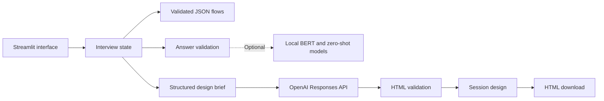

# Architecture

The Streamlit application coordinates a guided interview and optional AI code
generation. Domain logic can be tested without launching the interface.

## Interview state

`Interview` holds the selected page type, question index, and accepted answers.
Every browser session receives its own instance. An invalid or blank answer does
not change the question index or append an answer.

The eight flows contain 177 possible questions. Each step declares a question,
answer type, optional candidate labels, and a dependency. A dependency is `always`
or a previous choice (`yes`, `no`, `color`, or `image`). Consecutive alternatives
are evaluated against the answer that opened the branch. This prevents color
choices from accidentally displaying the alternative image question and fixes
the blog contact-form dependency.

Answers become a JSON design brief, preserving their association with each
question. The original concatenated prose fragments have been replaced by this
structured representation. Questions use consistent language and distinguish
visual prototypes from functional services.

## Classifier modes

The default mode requires exact candidate choices, accepts a small set of
yes/no aliases, and preserves text answers. It avoids silently interpreting a
free-text detail as a negative answer.

The optional research mode lazily loads classifiers on their first use. The
fine-tuned model label map remains unchanged to match the 263 trained outputs.
Inference pipelines are cached across sessions; interview answers and generated
designs are not. No model download takes place at import or normal startup.

## Generation and errors

The generation module calls the Responses API with a configured model, a timeout,
one retry, an output limit, and `store=False`. The service still receives the brief,
and edits also send the current HTML; see `SECURITY.md` for privacy limits.

Only completed responses containing a complete HTML document are accepted.
Raw HTML and a single fenced HTML block are supported. The validator rejects
scripts, event handlers, frames, form actions, external stylesheets, redirect
metadata, and URL attributes outside HTTPS or fragment links. It is a content
check, not a complete sanitizer. CSS and HTTPS content may still reference
external resources.

The app never executes generated code or injects generated HTML into its own
interface. The user can inspect and download the document. On generation failure,
the previous successful design stays available. General API errors are shown as
a generic message rather than printing raw request data or credentials.

## Storage and deployment

There is no database, shared output file, or automatic production deployment.
Session data is held by Streamlit and may be lost on server restart or session
expiration. Downloads are saved by the user's browser. Deployment of a reviewed
download is a separate action documented in `deployment.md`.
